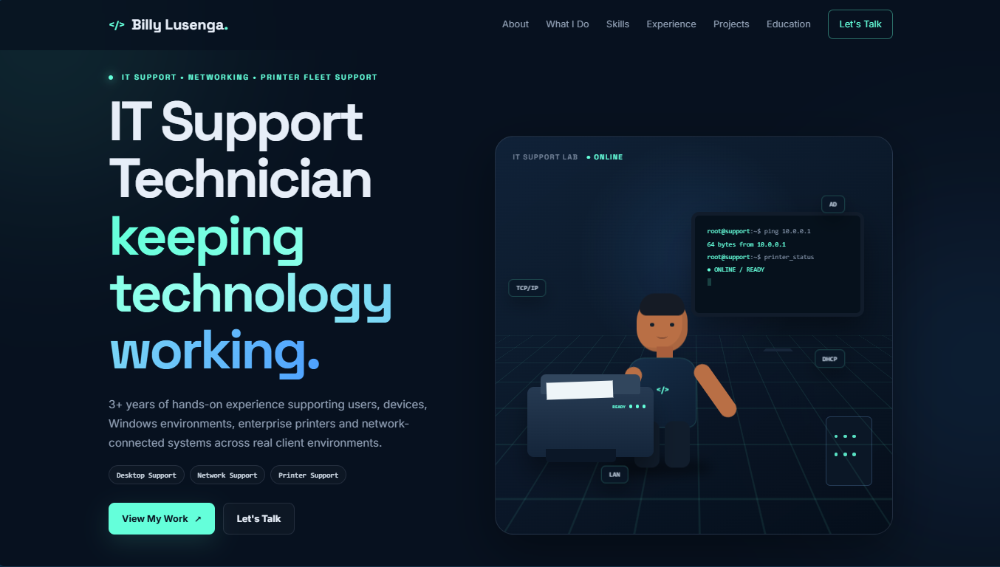

# Billy Lusenga — IT Portfolio


This is my portfolio project showing my experiences and skills I have learnt in the IT industry.

## Main projects

- `projects/enterprise-network-lab/` — 🌐 Enterprise Network Lab
- `projects/printer-fleet-management/` — 🖨️ Printer Fleet Management System
- `projects/it-support-dashboard/` — 🖥️ IT Support Dashboard

## Run locally

Open `index.html` in a browser, or serve the folder with any simple static web server.

## Portfolio GitHub structure

```text
/
├── Billy_Lusenga_Master_CV.pdf
├── index.html
├── assets/
│   └── certificates/
│       ├── Networking_Basics.pdf
│       ├── Networking_Essentials.pdf
│       ├── Network_Addressing_and_Basic_Troubleshooting.pdf
│       └── Network_Support_and_Security.pdf
├── css/
│   └── style.css
├── js/
│   └── script.js
├── projects/
│   ├── enterprise-network-lab/
│   │   └── index.html
│   ├── printer-fleet-management/
│   │   └── index.html
│   └── it-support-dashboard/
│       └── index.html
├── docs/
│   ├── PROJECTS_INDEX.md
│   ├── NETWORK-LAB-QUICK-REFERENCE.md
│   └── TechNexusInc Enterprise IT Infrastructure & Network Lab.pkt
└── README.md
```

## Project resources

The Cisco Packet Tracer network lab file is available under `docs/`. Supporting project documentation is also included in the `docs/` directory, and professional certificates are stored under `assets/certificates/`.
